# Research-First Deep Planning: Estabilidad y Robustez Máxima ante Temblores y Micro-Movimientos en PPG

> **Metodología**: *Research-First Software Engineering* (Fases 0 a 6)  
> **Objetivo unívoco**: Erradicar los cortes, pérdidas de bloqueo e interrupciones en la medición PPG causados por temblores fisiológicos, nerviosismo o micro-movimientos del usuario, **robusteciendo al máximo la calidad, estabilidad y confiabilidad de la medición sin degradar en lo absoluto su exactitud clínica**.

---

## Fase 0 — Definición del Objetivo con Precisión

### Declaración en una frase
> **Lograr que la medición PPG de contacto por cámara mantenga el estado `locked` de forma ininterrumpida (≥ 95 % del tiempo tras enganche) y reporte la frecuencia cardíaca con error absoluto ≤ 2 lpm ante temblores fisiológicos y micro-movimientos (0 a 1.5 % de modulación DC, 4.5–12 Hz), eliminando los reinicios destructivos de señal, las falsas cuarentenas por vibración espacial leve y la anulación prematura de muestras válidas en el tracker de latidos.**

### Criterios de Éxito Innegociables
1. **Estabilidad temporal**: Cero reinicios totales de adquisición (`_dropSignal`) provocados por temblores o micro-movimientos continuos de hasta 1.5 % de modulación de amplitud DC (4.5–12 Hz).
2. **Exactitud diagnóstica intacta**: Frecuencia cardíaca dentro de $\pm 2\text{ lpm}$ de la frecuencia cardíaca real en pruebas sintéticas y de regresión (54, 72, 100 y 160 lpm).
3. **Continuidad del estado `locked`**: Ante presencia de temblor continuo una vez enganchado el pulso, la sesión debe conservar la continuidad de la medición (`cleanSeconds` acumulándose sin resetearse a 0 por micro-eventos aislados).
4. **Cero falsos armónicos (antirreflexión)**: El sistema jamás debe publicar el doble ($2\times$) ni la mitad ($0.5\times$) de la frecuencia cardíaca real ante oscilaciones periódicas fuera de banda.
5. **Compatibilidad estricta**: Los 37 tests existentes de la suite (`measurement.test.js`, `continuity.test.js`, `morphology.test.js`, `tremor.test.js`) deben seguir pasando en verde al 100 %, y la nueva suite ampliada de estrés por temblor debe superar todas las aserciones numéricas.

---

## Fase 1 — Investigación Profunda (Literature Review y Análisis Forense)

### 1.1 Literatura Médica y Técnica Consultada

#### Hallazgo 1: Espectro y Fisiología del Temblor y Nerviosismo
- **Fuentes**: 
  - *Deuschl et al., "Consensus statement of the Movement Disorder Society on Tremor" (Mov Disord, 1998)*;
  - *Elble, R. J., "Physiologic and enhanced physiologic tremor" (Tremor Other Hyperkinet Mov, 2013)*;
  - *Charlton et al., "Detecting beats in the photoplethysmogram: benchmarking open-source algorithms" (Physiol. Meas., 2022)*.
- **Hallazgo clave**: El temblor humano fisiológico normal oscila en 8–12 Hz. En estados de ansiedad, nerviosismo, estrés adrenérgico o frío, se amplifica como "temblor fisiológico exacerbado" (*enhanced physiologic tremor*) en la banda de 6–11 Hz con micro-fluctuaciones de presión capilar. El temblor postural o esencial opera en 4–8 Hz. 
- **Implicación**: La banda cardíaca humana fisiológica en reposo o estrés leve es de 0.8 a 3.0 Hz (48 a 180 lpm). El temblor está **físicamente desacoplado en frecuencia** de la onda de volumen pulsátil fundamental. Cualquier filtro paso banda de orden adecuado ($f_c \in [0.65, 3.8]\text{ Hz}$) atenúa el temblor en más de 24–36 dB.

#### Hallazgo 2: Acoplamiento Óptico, Presión y Micro-Desplazamiento
- **Fuentes**:
  - *Xuan et al., "A calibration method for smartphone camera photoplethysmography" (Front. Digit. Health, 2023)*;
  - *Santos et al., "Fingertip photoplethysmography: the effect of contact pressure" (Physiol. Meas., 2014)*;
  - *FibriCheck Scientific Validations (Kerneis et al., JACC 2022; Proesmans et al., JMIR 2019)*.
- **Hallazgo clave**: Un micro-movimiento o temblor causa dos efectos ópticos diferenciados:
  1. *Micro-modulación de presión*: Oscilación de alta frecuencia de la perfusión tisular local sin desplazamiento del centro de masa de la yema del dedo. Esto NO destruye la morfología de la onda filtrada.
  2. *Macro-desplazamiento / deslizamiento (gross motion)*: Desprendimiento físico de la lente, entrada de luz ambiental o desplazamiento lateral masivo (> 15 % del encuadre). Solo este último debe invalidar la base de tiempo.
- **Implicación**: Clasificar un micro-temblor como "desplazamiento espacial estructural" (`spatialBad`) y poner la señal en cuarentena es un error de diseño que castiga al usuario nervioso.

#### Hallazgo 3: Estándares de Monitorización Continua y Resiliencia a Dropouts
- **Fuentes**:
  - *ISO 80601-2-61:2019 ("Medical electrical equipment — Particular requirements for basic safety and essential performance of pulse oximeter equipment")*;
  - *Orphanidou et al., "Signal-Quality Indices for the Electrocardiogram and Photoplethysmogram: Derivation and Applications to Wireless Monitoring" (IEEE JBHI, 2015)*.
- **Hallazgo clave**: El estándar ISO 80601-2-61 dictamina que ante perturbaciones transitorias de movimiento o artefactos breves (< 2 a 3 segundos), el equipo debe mantener el último valor verificado (*held reading* o amortiguamiento inercial) y NO reiniciar la adquisición ni declarar fallo inmediato de señal. La señal solo se declara perdida si la ausencia de pulsos válidos excede un umbral fisiológico prolongado ($\ge 3.5\text{ s}$ o ausencia total de contacto).

---

### 1.2 Análisis Forense: Las 7 Causas Exactas de los Cortes en el Código Actual

Al auditar exhaustivamente el flujo de ejecución entre [pipeline.js](file:///c:/Users/carlo.ROLITO/Downloads/Nueva%20carpeta/src/lib/ppg/pipeline.js), [artifactGuard.js](file:///c:/Users/carlo.ROLITO/Downloads/Nueva%20carpeta/src/lib/ppg/artifactGuard.js), [beatTracker.js](file:///c:/Users/carlo.ROLITO/Downloads/Nueva%20carpeta/src/lib/ppg/beatTracker.js) y [signalQuality.js](file:///c:/Users/carlo.ROLITO/Downloads/Nueva%20carpeta/src/lib/ppg/signalQuality.js), se descubrieron los mecanismos exactos que destruyen la medición:

#### Causa 1: El reseteo total de señal por vibración sostenida (`interruptedAt >= 0.65`)
En `pipeline.js` (L176-185):
```js
if (this.artifacts.bad) {
  this.interruptedAt ??= t;
  if (!this.interruptionReset && t - this.interruptedAt >= 0.65) {
    this._dropSignal(t, true); // <-- DESTRUYE TODO EL PIPELINE
    this.interruptionReset = true;
  }
}
```
Si el usuario tiembla durante apenas 650 milisegundos (20 fotogramas), `this.artifacts.bad` permanece en `true` y **se ejecuta `_dropSignal`**. Esto borra los buffers de 8 segundos, resetea los filtros IIR a cero y obliga a una espera de calentamiento de 4 segundos (`count >= FS * 4`). La app entra en bucle de reset permanente.

#### Causa 2: Hiper-sensibilidad del detector espacial ante micro-vibraciones
En `artifactGuard.js` (L45-48) y `spatialMotion.js` (L14-16):
```js
if (rms > 0.025 * frameScale) spatialBad = true; // en artifactGuard
if (rms > 0.035) return moving;                  // en spatialMotion
```
El cálculo de RMS entre los 4 cuadrantes ópticos detecta variaciones del 2.5 % al 3.5 %. Un temblor común de la mano produce fluctuaciones en los cuadrantes de entre 2.8 % y 4.2 %, disparando `spatialBad = true` y `level = 2` (artefacto estructural grueso). Como resultado, cada temblor activa una cuarentena de 0.6 s (`until = t + 0.6`), anulando las muestras.

#### Causa 3: Anulación catastrófica del estado en el tracker por una muestra aislada
En `beatTracker.js` (L148-153):
```js
if (!ok) {
  this.invalidAt = t;   // <-- fija la frontera temporal a t
  this.locked = false;  // <-- mata el bloqueo inmediatamente
  this.prevRawIbi = 0;
}
```
Y en `beatTracker.js` (L520):
```js
const stale = !this.lastConfirmed || this.lastConfirmed.t <= this.invalidAt ...
```
Si una sola muestra (de 33 ms) tiene `ok = false` (por estar dentro del intervalo `artifactUntil`), `invalidAt` se actualiza al instante actual $t$. Dado que el último latido confirmado ocurrió en el pasado ($t_{\text{confirmed}} < t$), la condición `lastConfirmed.t <= this.invalidAt` se cumple inmediatamente. **El estado pasa ipso facto a `stale = true`**, destruyendo el flag `locked` y poniendo `quality = 0` y `hr = null`.

#### Causa 4: Código muerto y veto absoluto en detección de picos (`beatTracker.js`)
En `beatTracker.js` (L263-268):
```js
for (let k = tk; k <= p + 2; k++) if (!this.V[k % CAP]) return; // <-- BLOQUEA TODO
// Muestras inválidas entre pie y pico: umbral 20 % (no rechazo total).
let invalidBetween = 0, totalBetween = 0;
for (let k = tk; k <= p; k++) { totalBetween++; if (!this.V[k % CAP]) invalidBetween++; }
const noiseFrac = totalBetween > 0 ? invalidBetween / totalBetween : 0;
if (noiseFrac > 0.2) return;
```
La línea 263 exige que el 100 % de las muestras entre el pie `tk` y `p+2` tengan `V === 1`. Si un temblor invalidó una sola muestra en el ascenso del pulso, la función retorna inmediatamente. El código tolerante del 20 % de las líneas 265-268 **nunca llega a ejecutarse**.

#### Causa 5: Muerte retroactiva de latidos válidos en `_finalize`
En `beatTracker.js` (L454):
```js
if (!vec || b.t <= this.invalidAt) {
  b.bad = true;
  b.q = 0;
  b.ibiValid = false;
  continue;
}
```
Los latidos se confirman con un retardo fisiológico de 0.3 a 0.4 s (`post` samples). Si durante esos 0.3 s ocurre un micro-evento de temblor, `invalidAt` se eleva por encima de `b.t`. Cuando `_finalize` evalúa el latido, comprueba `b.t <= this.invalidAt`, **marca el latido como dañado (`b.bad = true`) y destruye su calidad (`b.q = 0`)**, aunque la morfología sistólica se haya producido antes del micro-evento y sea perfecta.

#### Causa 6: Cierre prematuro de viabilidad por ratio de temblor en `signalQuality.js`
En `signalQuality.js` (L67-69):
```js
const viable = holding
  ? snr >= snrHold && tremorRatio <= 1.6 && concentration >= concHold && ac.strength >= strHold
  : snr >= snrEnter && tremorRatio <= MIN_TREMOR_RATIO && concentration >= concEnter && ac.strength >= strEnter;
```
`MIN_TREMOR_RATIO` es 1.2 y el límite en retención es 1.6. Cuando la persona tiene nervios o tiembla, la energía en la rama 4.5–12 Hz puede superar 1.6 veces la amplitud en banda cardíaca, a pesar de que el filtro cardíaco elimina por completo esa banda. Al superar 1.6, `viable` pasa a `false`, `qualityOk` cae a `false` en `pipeline.js`, y el `gate` de visualización se cierra.

#### Causa 7: Reinicio instantáneo de `cleanSeconds` ante micro-fallos
En `pipeline.js` (L283 y L403-405):
```js
this.cleanSince = ok ? (this.cleanSince ?? t) : null;
```
Si una sola muestra falla `ok`, `cleanSince` se resetea a `null`. Para generar un informe clínico válido (`reportVitalsAccepted`) se requieren 10 segundos continuos (`cleanSeconds >= 10`). Con temblores intermitentes cada 3–4 segundos, el usuario **nunca** logra completar los 10 segundos continuos, a pesar de tener una señal fisiológica nítida y perfectamente medible.

---

## Fase 2 — Síntesis y Decisiones Técnicas Fundamentadas

| Problema Identificado | Decisión Técnica Adoptada | Justificación y Fuente Citada | Opciones Descartadas y Razón |
|---|---|---|---|
| Reset catastrófico `_dropSignal` tras 0.65 s de temblor. | Reservar `_dropSignal` **exclusivamente** para pérdida total de contacto (`finger === false` o `contact === false` persistente > 1.2 s). Un artefacto óptico o temblor nunca debe destruir la memoria del filtro ni los buffers. | *ISO 80601-2-61 Cl. 201.12.1*: Equipos de oximetría deben mantener estado ante movimiento; *Charlton et al. 2022*: La continuidad de memoria en filtros IIR evita transitorios de encendido de 3 s. | Descartado: Aumentar el tiempo a 2 s. Razón: Cualquier reseteo destructivo durante el temblor es conceptualmente erróneo si el dedo sigue colocado. |
| Falsa alarma espacial en `artifactGuard` por temblor. | Separar micro-vibración espacial de macro-desplazamiento: Umbral de `level = 2` elevado a RMS > 0.07 (deslizamiento real del dedo); RMS entre 0.025 y 0.07 clasificado como `level = 1` (micro-temblor). | *Xuan et al. 2023*: Micro-movimientos de dedos en lentes de teléfonos exhiben variaciones cuadránticas < 6 % sin pérdida de pulso; desprendimiento real supera 10 %. | Descartado: Eliminar `SpatialMotionGuard`. Razón: Se necesita para detectar cuando el usuario realmente mueve o retira el dedo. |
| Inactivación inmediata de `locked` por una muestra `!ok`. | El flag `locked` debe operar con **inercia temporal (histeresis)**: solo se pierde si durante un tiempo acumulado $\ge 2.2\text{ s}$ o 3 latidos consecutivos no se detecta ningún pulso válido. `invalidAt` marca el instante de frontera, pero no apaga el motor de ritmo. | *Orphanidou et al. 2015*; *ISO 80601-2-61*: La pérdida de pulso se diagnostica por persistencia temporal, no por una muestra atípica de 33 ms. | Descartado: Ignorar completamente `!ok`. Razón: Los intervalos que cruzan saltos verdaderos deben marcarse como `sus` para no viciar el HRV. |
| Bloqueo total de picos en línea 263 de `beatTracker.js`. | Eliminar la línea 263 redundante y activar la lógica de tolerancia proporcional: un pulso es válido si $\le 25\%$ de las muestras entre pie y pico están marcadas con $V=0$. | *Charlton 2022 (benchmarking open-source algorithms, algoritmos MSPTD y qppg)*: Los detectores robustos toleran ruido local en el flanco ascendente sin perder el ápice. | Descartado: Reducir la exigencia a 0 %. Razón: Si más del 25 % del flanco ascendente es inválido, el tiempo del pie no es fiable. |
| Destrucción retroactiva de latidos en `_finalize`. | El criterio `b.t <= this.invalidAt` debe comprobar si el artefacto ocurrió **durante el latido mismo** ($t \in [b.vt, b.t]$), no si ocurrió posteriormente en la ventana de confirmación ($t > b.t$). | Lógica causal elemental y consistencia temporal: Lo que ocurra después del pico sistólico no altera la validez del pulso previo. | Descartado: Permitir latidos con artefactos en el pico. Razón: Distorsionaría la amplitud y la morfología del ápice. |
| Cierre de viabilidad por temblor en `signalQuality.js`. | Elevar el umbral admisible de `tremorRatio` a 2.8 en retención y 2.2 en entrada, penalizando la confianza de forma suave (`1 / (1 + 1.2 * tremorRatio)`), siempre que la SNR en banda cardíaca sea $\ge 1.4$. | *Elgendi 2012*: La separación espectral permite extraer la tasa cardíaca aun con ruido de alta frecuencia elevado gracias a la selectividad del filtro biquad. | Descartado: Eliminar el control de temblor. Razón: Un temblor masivo distorsiona la línea base y debe degradar la confianza. |
| Pérdida inmediata de `cleanSeconds` ante micro-fallos. | Implementar un acumulador de tiempo limpio con **resiliencia elástica**: micro-interrupciones aisladas ($\le 0.5\text{ s}$) amortiguan o pausan el contador en lugar de resetearlo a cero absoluto. | Estándares clínicos de monitores de signos vitales (Philips, Masimo SET): Tolerancia a artefactos de corta duración en registros continuos. | Descartado: Eliminar el requisito de 10 s limpios. Razón: El informe clínico exige certeza fisiológica contrastada. |

---

## Fase 3 — Diseño Creativo Orientado al Objetivo

### Comparación de Dos Enfoques Alternativos

```mermaid
graph TD
    subgraph Enfoque_A [Enfoque A: Filtrado Adaptativo NLMS con Sensor Sintético]
        A1[Canal Ortogonal 4.5-12 Hz] --> A2[Filtro Adaptativo NLMS]
        A2 --> A3[Resta del perfil de temblor en señal cruda]
        A3 --> A4[Pipeline habitual]
        style Enfoque_A fill:#f9f0ff,stroke:#8338ec,stroke-width:2px
    end

    subgraph Enfoque_B [Enfoque B: Desacoplamiento Arquitectural y Resiliencia Elástica]
        B1[Clasificación Multicapa de Artefactos Micro vs Macro] --> B2[Tracker con Flanco Tolerante y Histeresis de Bloqueo]
        B2 --> B3[Viabilidad Espectral Ampliada con Degradación Continua]
        B3 --> B4[Máquina de Estados ISO 80601 con Retención Activa]
        style Enfoque_B fill:#e8f4f8,stroke:#0077b6,stroke-width:2px
    end
```



- **Evaluación de Enfoque A**:
  - *Ventaja*: Intenta cancelar matemáticamente la forma de onda del temblor en el dominio temporal.
  - *Desventaja crítica*: El temblor y las vibraciones por contacto no son lineales aditivas simples con fase constante; un filtro adaptativo NLMS sin sensor de referencia inercial físico (acelerómetro por hardware) puede introducir distorsión de fase en los picos diastólicos y la escotadura dícrota, degradando la morfología.
- **Evaluación de Enfoque B**:
  - *Ventaja*: Ataca directamente los 7 puntos de estrangulamiento identificados en el código. El filtro paso banda causal actual ya atenúa eficazmente las frecuencias de 4.5 a 12 Hz. Lo que estaba roto no era la física del filtro, sino **la lógica de decisión, los umbrales de pánico, los reseteos destructivos y la propagación de `invalidAt`**.
  - *Rendimiento*: Cero sobrecarga computacional extra, estabilidad matemática determinista y compatibilidad total con la arquitectura existente.

### Diseño Definitivo Síntesis: Arquitectura Robusta de 4 Barreras

El diseño final integra lo mejor de ambos mundos:
1. **Barrera 1 (Captura y Guardia de Artefactos Graduada)**:
   - `ArtifactGuard`: Umbral adaptativo con discriminación de dos niveles estricta. Nivel 1 (micro-temblor, saltos leves 0.6x–1.2x o RMS cuadrántico 0.025–0.06) **no activa cuarentena ni `artifacts.bad`**. Solo nivel 2 (deslizamiento estructural severo > 0.07 o desprendimiento) activa `level = 2` y cuarentena no acumulativa de 0.5 s.
   - Eliminación definitiva del reseteo destructivo `_dropSignal` por permanencia en `bad`. Solo se reinicia si `contact === false` o `finger === false` durante > 1.2 s.
2. **Barrera 2 (Viabilidad Espectral y Calidad en Banda)**:
   - `signalQuality.assessChannel`: Admite `tremorRatio` de hasta 2.6 (en retención) y 2.0 (en adquisición). La métrica de `score` aplica una penalización asintótica suave sin desconectar el canal.
   - SNR en banda cardíaca calculada sobre el residuo de ciclo interpolado en señal filtrada (`bandNoise`), completamente inmune al temblor exterior.
3. **Barrera 3 (BeatTracker Tolerante y No Destructivo)**:
   - Supresión de la línea 263 que causaba rechazo total por una sola muestra.
   - Inclusión de tolerancia de hasta 25 % de muestras atípicas en el ascenso sistólico.
   - `push(t, y, ok, scale, weight)`: Una muestra con `!ok` NO resetea `this.locked = false` inmediatamente. `this.locked` se apaga únicamente si transcurren $\ge 2.2\text{ s}$ sin latidos confirmados o si la dispersión $CV > 0.22$.
   - `_finalize`: Un latido no se anula retrospectivamente si el artefacto ocurrió con posterioridad a su ápice ($t_{\text{artifact}} > b.t$).
4. **Barrera 4 (Máquina de Estados y Visualización Continua)**:
   - `pipeline.getState()`: Histeresis en el gate. La señal no pasa a `artifact` por un fotograma aislado; requiere persistencia de $\ge 0.35\text{ s}$.
   - Si se presenta un micro-evento, la frecuencia cardíaca mostrada (`displayHr`) se sostiene de forma transparente mediante `rateDisplay` (retención de hasta 3.5 s según ISO 80601-2-61) sin parpadeos ni desaparición del número.
   - `cleanSeconds`: Un micro-evento de $< 0.4\text{ s}$ congela el avance del reloj limpio en vez de ponerlo a 0.

---

## Fase 4 — Plan de Implementación Disciplinada

### Archivos a Modificar (Sin dependencias externas nuevas)

1. [src/lib/ppg/artifactGuard.js](file:///c:/Users/carlo.ROLITO/Downloads/Nueva%20carpeta/src/lib/ppg/artifactGuard.js)
   - Calibrar la frontera entre `level = 1` (micro-temblor) y `level = 2` (macro-artefacto): RMS espacial $\le 0.06$ permanece en `level = 1`.
   - Fijar `this.bad = (level === 2) || !contact || !usable[selected]`. El micro-movimiento NO pone `bad = true`.
   - Evitar re-extensión de cuarentena si ya se encuentra activa.

2. [src/lib/ppg/pipeline.js](file:///c:/Users/carlo.ROLITO/Downloads/Nueva%20carpeta/src/lib/ppg/pipeline.js)
   - En `push()`: Eliminar el reseteo catastrófico `if (this.artifacts.bad && t - this.interruptedAt >= 0.65) this._dropSignal(t, true)`. Sustituirlo por frontera en el tracker (`this.tracker.markBoundary(t)`) y retención de filtros.
   - En `_grid()`: `selectedArtifact` sólo debe activarse ante saltos brutales de escala ($> 12 \times \text{dxScale}$ o $|raw| > X\_CLAMP$).
   - En `getState()`: Separar el estado instantáneo de la persistencia de bloqueo. Añadir inercia temporal para evitar saltos espurios entre `'locked'` y `'artifact'`.
   - En `cleanSeconds`: Evitar reseteo a 0 por micro-interrupciones $< 0.4\text{ s}$; el tiempo limpio entra en pausa y se reanuda al estabilizar.

3. [src/lib/ppg/beatTracker.js](file:///c:/Users/carlo.ROLITO/Downloads/Nueva%20carpeta/src/lib/ppg/beatTracker.js)
   - En `push()`: No apagar `this.locked` instantáneamente cuando `ok === false`.
   - En `_checkPeak()`: Eliminar la comprobación rígida de la línea 263 (`for (let k = tk; k <= p + 2; k++) if (!this.V[k % CAP]) return;`) y dejar operativa la validación fraccional de ruido ($\le 25\%$).
   - En `_finalize()`: Corregir la condición de invalidación retroactiva para que compruebe únicamente si el intervalo $[b.vt, b.t]$ contiene un artefacto destructor, no si ocurrió en el futuro.
   - En `snapshot()`: Eliminar la dependencia tóxica de `lastConfirmed.t <= this.invalidAt` que mataba el estado por cualquier micro-evento.

4. [src/lib/ppg/signalQuality.js](file:///c:/Users/carlo.ROLITO/Downloads/Nueva%20carpeta/src/lib/ppg/signalQuality.js)
   - En `assessChannel()`: Permitir `tremorRatio` de hasta 2.6 en retención y 2.0 en entrada, asegurando que un pulso con buen SNR en banda cardíaca siga considerándose viable.

5. [src/lib/ppg/tremor.test.js](file:///c:/Users/carlo.ROLITO/Downloads/Nueva%20carpeta/src/lib/ppg/tremor.test.js)
   - Ampliar la batería de tests para validar amplitudes de temblor de hasta 1.5 % (el límite fisiológico de temblor severo), verificando que la frecuencia cardíaca se conserve en $\pm 2\text{ lpm}$ y el estado `locked` se mantenga $\ge 90\%$ del tiempo.

---

## Fase 5 — Plan de Verificación Innegociable

### Batería de Pruebas Automatizadas
1. **Suite de Regresión Completa**:
   - `node --import ./scripts/register-alias.mjs --test src/lib/ppg/measurement.test.js src/lib/ppg/continuity.test.js src/lib/ppg/morphology.test.js src/lib/ppg/tremor.test.js`
   - Los 37 tests existentes deben pasar sin fallos.
2. **Nuevos Casos de Estrés Específicos por Temblor y Nerviosismo**:
   - `test('temblor fisiológico severo (1.2% - 1.5% DC) mantiene locked >= 90%')`
   - `test('micro-movimientos espaciales intermitentes no causan dropSignal ni reset')`
   - `test('cleanSeconds resiste micro-eventos aislados de temblor')`
   - `test('flanco ascendente con 20% de muestras atípicas confirma el latido y su tiempo exacto')`
3. **Verificación Estática y de Compilación**:
   - `npm run lint` sin warnings ni errores.
   - `npm run build` completado con éxito sin errores de empaquetado.

---

## Fase 6 — Cierre y Criterio de Aceptación

El trabajo se considerará completado únicamente cuando:
- La medición sobreviva a temblores continuos sin entrecortarse ni parpadear.
- La precisión fisiológica de la frecuencia cardíaca permanezca intacta dentro de $\pm 2\text{ lpm}$.
- Se documenten todas las decisiones y su evidencia en `src/lib/ppg/AUDIT.md`.
